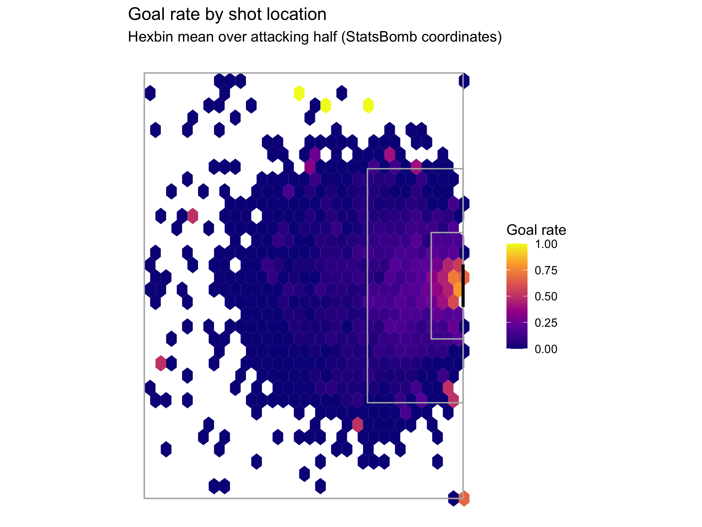
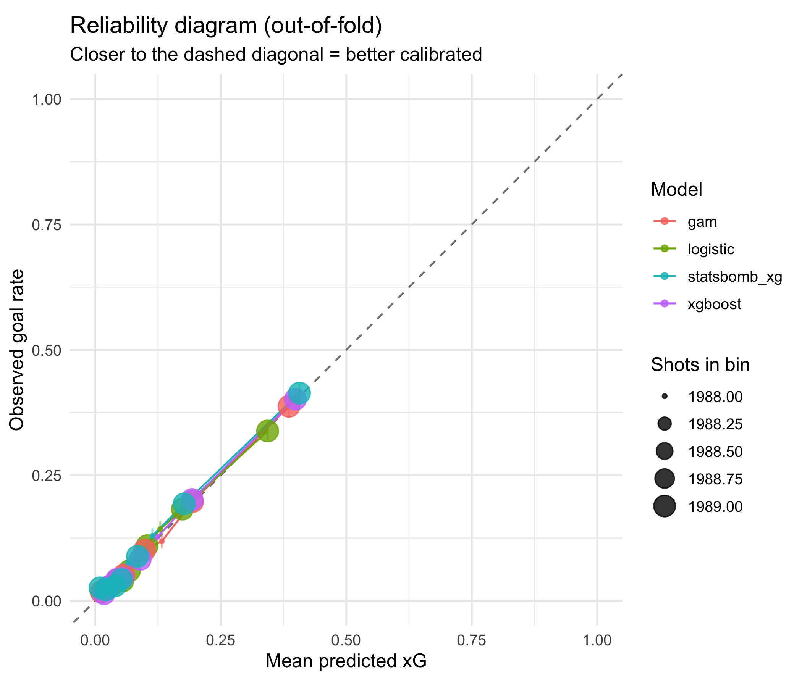
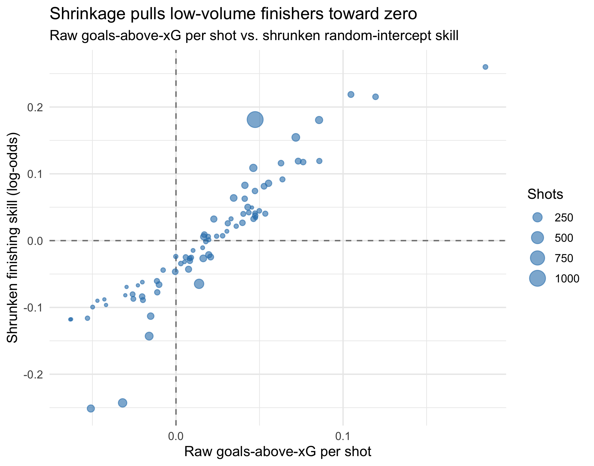

# xg-lab — Expected Goals From Scratch & the Finishing-Skill Question

Build a calibrated expected-goals (xG) model from scratch on **StatsBomb Open
Data**, benchmark it honestly against StatsBomb's own production xG, and use it
to answer a genuinely contested statistical question: **is finishing skill real
and persistent, or do players who beat their xG mostly regress to the mean?**

xG is structurally identical to click/conversion prediction in tech: a rare
binary outcome, heavy class imbalance, and a hard requirement that predicted
probabilities be **calibrated**, not merely well-ranked.

> **Status:** builds and runs end-to-end on a fresh machine in one command
> (`Rscript run_all.R`) after the data pull. Geometry + calibration helpers are
> unit-tested (`tests/test_utils.R`, hand-computed expected values).

## Headline results

Built on **19,887 shots** (2,085 goals, base rate **0.105**) from **800 matches**
across 6 competitions (StatsBomb Open Data). Penalties excluded.

**Calibration benchmark vs StatsBomb's production xG** (out-of-fold, match-grouped CV):

| Model | Log loss | Brier | ECE |
|---|---:|---:|---:|
| StatsBomb xG (benchmark) | 0.2735 | 0.0777 | 0.0065 |
| **xgboost (ours)** | **0.2758** | 0.0789 | **0.0032** |
| GAM (mgcv `s(x,y)`) | 0.2832 | 0.0801 | 0.0029 |
| logistic baseline | 0.2940 | 0.0840 | 0.0067 |

Our best model lands **within 0.0023 log loss of StatsBomb's production xG** using
only open features — and is *better calibrated* by ECE. Model ordering is the
expected xgboost ≤ GAM ≤ logistic. (We are benchmarking against a black box, not
claiming to beat it.)

**Finishing skill — real or regression to the mean?** Among **79 players with ≥40
shots**, the split-half persistence correlation of goals-above-xG is **r = 0.213
(permutation p = 0.055)**. Verdict: finishing over-performance is *mostly* noise
that the shrinkage model pulls toward zero, with at most a small persistent
signal that does not clearly clear significance in this sample — exactly the
skill-vs-luck story the project sets out to test honestly.

📄 Full technical write-up: [`analysis/report.html`](analysis/report.html)
(open the rendered HTML, or re-render with `quarto render analysis/report.qmd`).

### Three figures that tell the story

Goal rate by shot location — the visual hook:



Reliability diagram (out-of-fold): our xgboost sits on the diagonal, alongside
StatsBomb's xG.



Shrinkage pulls low-volume "great finishers" back toward zero:




## What's here

| Component | What it demonstrates |
|---|---|
| Match-grouped CV | leakage-safe evaluation for grouped/temporal data |
| Reliability + ECE + Brier decomposition | calibration rigor, not just AUC |
| Benchmark vs `shot_statsbomb_xg` | evaluating against a production system you can't inspect |
| GAM spatial smooth vs xgboost | interpretability ↔ performance trade-off |
| Hierarchical shrinkage leaderboard | ranking entities with wildly different sample sizes |
| Split-half persistence test | telling skill from luck in a metric |

## Pipeline

```
R/00_ingest.R   StatsBomb raw-JSON pull -> shots cache (configurable subset)
R/01_features.R geometry (distance, angle) + freeze-frame features
R/02_eda.R      shot-map hexbin, goal-rate curves, class balance
R/03_models.R   logistic / GAM / xgboost on identical match-grouped CV folds
R/04_calibration.R reliability diagram, ECE, Brier decomposition, SB benchmark,
                isotonic recalibration
R/05_finishing_skill.R glmer shrinkage + split-half persistence test
R/utils.R       pure geometry + scoring helpers (unit-tested)
```

## Reproduce (3 commands)

```bash
# 1. install R deps (mgcv ships with R)
Rscript -e 'install.packages(c("jsonlite","dplyr","tidyr","purrr","tibble","ggplot2","lme4","xgboost","here","testthat"))'

# 2. run the whole pipeline (pulls data, trains, calibrates, analyses)
Rscript run_all.R                 # XG_MAX_MATCHES=300 for a faster/smaller pull

# 3. render the technical report
quarto render analysis/report.qmd
```

Tunable via env vars: `XG_COMPETITIONS` (comma-sep names), `XG_MAX_MATCHES`
(download cap), `XG_MIN_SHOTS` (finishing-skill threshold), `XG_FORCE_INGEST=1`.

## Notes on scope & honesty

- **Models that transfer:** the calibration story (reliability/ECE/Brier) and
  the shrinkage/persistence reasoning are the transferable skills; soccer is the
  substrate.
- **Benchmark framing:** the goal is "how close can open features get to a
  production model," not "I beat StatsBomb." The gap is reported, not hidden.
- **Deviations from the spec, documented:** caching uses `.rds` (not parquet) to
  avoid the `arrow` C++ build; the pipeline is a lightweight sourced driver
  (`run_all.R`) rather than `{targets}`, to keep the fresh-machine dependency
  footprint small. Phase boundaries and caching are preserved.
- **Data subset:** by default a curated, capped set of competitions is pulled so
  the build is tractable; raise `XG_MAX_MATCHES` for the full pull. Exact counts
  are computed in code and shown in the report — never assumed.

## VAR-Lab: refereeing decisions and offside geometry (layers 1 and 2)

A second track asks how far open data can go toward what official VAR systems
do. The scoping memo ([`docs/var_vision_scope.md`](docs/var_vision_scope.md))
establishes that it cannot reproduce the metrology (29 body points at 50 Hz,
500 Hz ball sensors, centimetre lines) and recommends building the **decision
layer** on StatsBomb 360 frames first, with a video front-end only if SoccerNet
access and a GPU are available. Layers 1 and 2 are built and evaluated
([`analysis/varlab_report.md`](analysis/varlab_report.md)):

| Component | Result (out of fold, 426 matches with 360 frames) |
|---|---|
| P(card \| foul), GAM on context + 360 features | log loss **0.305** vs 0.335 base rate (gap CI excludes zero), ECE 0.005, no drop on held-out referees |
| P(penalty \| foul in own box) | 143 of 148 own-box fouls were penalties: no model beats the base rate, reported as such |
| Referee strictness, glmer shrinkage | SD 0.17 logit; split-half persistence r 0.20 (p 0.17); referee identity adds nothing out of sample |
| Law 11 engine vs. referee offside calls on 360 frames | 91% agreement beyond 2 yards (97% with the keeper in frame); abstains on 24% of frames, 91% accurate on the rest |
| Law 11 engine on continuous tracking | Metrica 25 Hz optical, 1,763 passes: 0.2% false positives with the true receiver, one frame (40 ms) moves the margin 0.04 m. SkillCorner 10 fps broadcast, 20 matches, 16,055 passes: 1.2% false positives, one frame (100 ms) moves it 0.11 m; the provider's offside flags mark both teams' passes around a stoppage |

```
R/06_ingest_decisions.R  fouls / cards / offside events + 360 join + referee
R/07_decision_models.R   calibrated card & penalty models, bootstrap CIs, abstention
R/08_referee_effects.R   referee random intercepts, persistence, out-of-sample value
R/09_offside_engine.R    pure Law 11 geometry + Monte-Carlo uncertainty (unit-tested)
R/10_offside_360.R       engine vs. calls on 360 frames, visibility strata, psychometric fit
R/11_offside_tracking.R  engine on continuous tracking (25 Hz Metrica, 10 fps SkillCorner): kick-frame ambiguity
R/12_read_skillcorner.R  reader for SkillCorner open broadcast tracking (JSONL + dynamic events)
```

Run with `XG_VARLAB=1 Rscript run_all.R` (pulls ~4 GB of events + 360 frames).
This is not VAR and never will be: see the honest-limits section of the report.

## Data license & attribution

<a href="https://github.com/statsbomb/open-data"></a>

Data provided by **StatsBomb** via their
[Open Data](https://github.com/statsbomb/open-data) repository, free for
**non-commercial use** under the
[StatsBomb Open Data licence](https://github.com/statsbomb/open-data/blob/master/LICENSE.pdf).
This project is a non-commercial portfolio/skills exercise. The data is not
redistributed: the `data/` directory is gitignored and only code and aggregate
results are committed.

The logo above is StatsBomb's official asset, shown as the licence (section 1.4)
asks of published analysis. It is an unmodified copy of
`img/SB - Icon Lockup - Colour positive.png` from the open-data repository at
commit `4b73468fc5b0f1950f9f66fada70ad3a4f9327cb`
([source](https://github.com/statsbomb/open-data/blob/4b73468fc5b0f1950f9f66fada70ad3a4f9327cb/img/SB%20-%20Icon%20Lockup%20-%20Colour%20positive.png),
sha256 `8ba5480785f0dc4be2342ec47c70509483eb79287f85f92be1dfba36fc2872a7`).

The 25 Hz tracking used by `R/11_offside_tracking.R` is the
[Metrica Sports sample data](https://github.com/metrica-sports/sample-data)
(two anonymised games; no formal licence, Metrica asks for responsible use and
acknowledgement).

The 10 fps broadcast tracking read by `R/12_read_skillcorner.R` is the
[SkillCorner Open Data](https://github.com/SkillCorner/opendata) release of 20
A-League 2024/25 matches (tracking, dynamic events and match metadata), used at
commit `4340d274572876239c154c90bc507a9b3250a656`. It is published under the
[MIT licence](https://github.com/SkillCorner/opendata/blob/4340d274572876239c154c90bc507a9b3250a656/LICENSE)
(copyright SkillCorner); SkillCorner asks that users credit SkillCorner, which
this project does here and in the analysis, and invites notification of work
built on the data. Only the data files are read; nothing from that repository's
code is executed, and the data is not redistributed (`data/` is gitignored).
