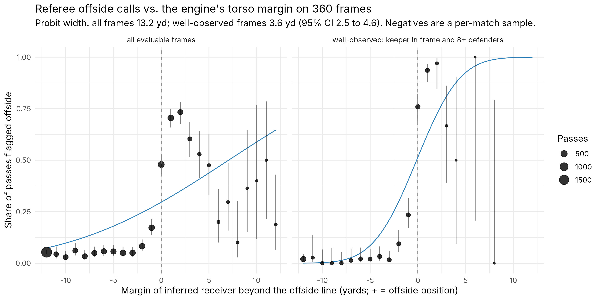

# Law 11 engine vs. referee offside calls on StatsBomb 360 frames (VAR-Lab layer 2b)

Generated by `R/10_offside_360.R` on 2026-10-14. Frames: 6643 with 360 data, 6632 evaluable (actor present, >= 2 defenders, a candidate receiver). Monte Carlo: sigma = 1.0 yd on every position, 300 draws.

Receiver rule: nearest teammate to the pass end location (frames carry no player ids). Negatives: 15 completed forward passes into the opponent's half sampled per match; positives: every pass with outcome Pass Offside.

## Agreement by visibility stratum (inferred receiver)

| Stratum | n | Offside calls | Sensitivity (margin > 0) | Non-calls | False-positive rate | Agreement [95% CI] | n beyond 2 yd | Agreement beyond 2 yd [95% CI] |
|---|---|---|---|---|---|---|---|---|
| all evaluable frames | 6632 | 1174 | 0.676 | 5458 | 0.087 | 0.871 [0.862, 0.879] | 5069 | 0.908 [0.900, 0.916] |
| opposing keeper in frame | 1689 | 368 | 0.736 | 1321 | 0.022 | 0.925 [0.912, 0.937] | 1157 | 0.974 [0.963, 0.982] |
| opposing keeper NOT in frame | 4943 | 806 | 0.649 | 4137 | 0.108 | 0.852 [0.842, 0.862] | 3912 | 0.889 [0.878, 0.898] |
| inferred receiver inside visible area | 6355 | 1152 | 0.674 | 5203 | 0.087 | 0.870 [0.861, 0.878] | 4842 | 0.907 [0.899, 0.915] |
| inferred receiver outside visible area | 277 | 22 | 0.818 | 255 | 0.102 | 0.892 [0.850, 0.923] | 227 | 0.925 [0.883, 0.953] |
| 8+ defenders visible | 5101 | 890 | 0.746 | 4211 | 0.047 | 0.917 [0.909, 0.924] | 3881 | 0.958 [0.951, 0.964] |
| < 8 defenders visible | 1531 | 284 | 0.458 | 1247 | 0.225 | 0.717 [0.693, 0.739] | 1188 | 0.744 [0.719, 0.768] |
| ground passes | 4557 | 445 | 0.856 | 4112 | 0.058 | 0.933 [0.926, 0.940] | 3725 | 0.966 [0.959, 0.971] |
| lofted / high passes | 2075 | 729 | 0.567 | 1346 | 0.176 | 0.733 [0.714, 0.752] | 1344 | 0.749 [0.725, 0.771] |

## Furthest-forward attacker rule (any attacker in an offside position)

| Stratum | n | Offside calls | Sensitivity (margin > 0) | Non-calls | False-positive rate | Agreement [95% CI] | n beyond 2 yd | Agreement beyond 2 yd [95% CI] |
|---|---|---|---|---|---|---|---|---|
| all evaluable frames (furthest-forward attacker) | 6632 | 1174 | 0.780 | 5458 | 0.402 | 0.630 [0.619, 0.642] | 2799 | 0.596 [0.578, 0.614] |
| opposing keeper in frame (furthest-forward) | 1689 | 368 | 0.853 | 1321 | 0.221 | 0.795 [0.775, 0.814] | 512 | 0.869 [0.837, 0.896] |

## Psychometric fit

| Subset | n | Width sigma (yd) [95% CI over matches] | Point of subjective equality (yd) | AUC of margin |
|---|---|---|---|---|
| all evaluable frames | 6632 | 13.17 [11.26, 15.54] | 7.06 [5.45, 9.24] | 0.826 |
| well-observed: keeper in frame and 8+ defenders | 1598 | 3.56 [2.54, 4.63] | -0.13 [-0.51, 0.37] | 0.948 |

The all-frames width bundles 360 positional precision, receiver mis-identification, defenders outside the camera view, torso-vs-limb offsets, and kick-point timing; it is a failure measure of the whole chain, not a precision estimate. The well-observed width is the closer proxy for 360 positional noise plus receiver inference. The point of subjective equality is sampling-dependent (negatives are a per-match sample).

## Three-way Monte-Carlo call vs. referee

| Engine call | Referee: no call | Referee: offside | Total |
|---|---|---|---|
| offside | 213 | 221 | 434 |
| onside | 4388 | 240 | 4628 |
| refer | 857 | 713 | 1570 |

Coverage (frames the engine is willing to call at sigma = 1.0 yd): 0.763. Accuracy on called frames: 0.911.

## Caveats

- 360 frames are 2D torso-level snapshots of the players the camera could see; the second-last defender may be out of frame (see keeper strata).
- Whether the Pass Offside frame is sampled at the true kick point is undocumented by StatsBomb.
- A non-call is not proof of an onside position: a player in an offside position who does not interfere is not flagged (Law 11.2), which inflates the furthest-forward rule's false-positive rate by design.

