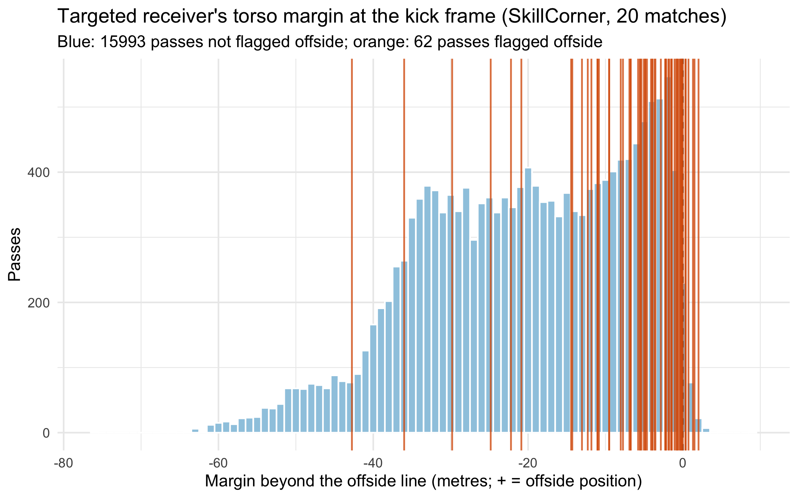

# Law 11 engine on continuous tracking

The pure Law 11 engine (`R/09_offside_engine.R`) evaluated at the kick frame of every pass in two tracking datasets of different kinds: 25 Hz optical tracking (Metrica Sports) and 10 fps broadcast tracking (SkillCorner). Every number below is computed by `R/11_offside_tracking.R`; nothing is typed by hand. Positive margin = the receiver is beyond the offside line (an offside position, not necessarily an offence).

## Metrica Sports sample games 1 and 2 (25 Hz optical tracking)

Generated by `R/11_offside_tracking.R` on 2026-10-18. Passes evaluated: 1763 (1 flagged offside by the data provider). Positions at the kick frame, 25 Hz, metres.

### False-positive rate on passes that were NOT flagged offside

| Receiver rule | Share with margin > 0 | 95% CI | n |
|---|---|---|---|
| true | 0.002 | [0.001, 0.006] | 1762 |
| nearest_end | 0.002 | [0.001, 0.005] | 1762 |
| furthest_forward | 0.148 | [0.132, 0.165] | 1762 |

The nearest-to-end-point rule picked the true receiver in 97.1% of the 1763 passes with a known end point.

### Kick-frame ambiguity (what one frame of timing error does to the margin)

- Shifting the kick frame by 1 frame (40 ms) moves the margin by a median of 0.04 m (90th percentile 0.12 m); by 2 frames (80 ms): median 0.08 m, p90 0.23 m.
- The sign of the margin flips in 0.0% of passes with a 1-frame shift and 0.0% with a 2-frame shift.
- A 1-frame shift moves the margin by more than 5 cm (the reported manual-line tolerance of the official systems, unverified) in 42.8% of passes and by more than 10 cm in 14.4%; a 2-frame shift exceeds 5 cm in 68.1%. This is why the official systems need a 500 Hz ball sensor or 100 fps cameras to fix the kick point.

### Three-way Monte-Carlo call (sigma = 0.3 m, sigma_t = 0.02 s) vs. provider flag

| Engine call | Not flagged | Flagged offside |
|---|---|---|
| offside | 3 | 0 |
| onside | 1752 | 0 |
| refer | 7 | 1 |

### The flagged offsides (case studies)

| Game | Period | Kick frame | Passer | Receiver | Margin (m) | Second-last defender x | Ball x | P(offside) MC | Call |
|---|---|---|---|---|---|---|---|---|---|
| Sample_Game_1 | 1 | 29468 | Player19 | Player18 | 0.57 | 89.67 | 77.77 | 0.91 | refer |

### Caveats

- Only 1 provider-flagged offside(s) follow a PASS event in these two games (a second flagged offside followed a ball recovery, not a pass, and is excluded): sensitivity cannot be estimated here; the false-positive rate can.
- A positive margin on an unflagged pass is not necessarily an error: an offside-positioned receiver who is not interfering is not flagged, and some passes are intercepted before any offence.
- Tracking centroids are torso-level; limb-level offsets are not measurable without pose data.
- Attacking direction is inferred from kick-off positions; ball position comes from tracking when available, else the passer's location.

## SkillCorner A-League 2024/25 (10 fps broadcast tracking, 20 matches)

Generated by `R/11_offside_tracking.R` (reader `R/12_read_skillcorner.R`) on 2026-10-18. Passes evaluated: 16055 of 16069 pass-ending possessions with a targeted receiver (62 flagged `offside` by SkillCorner's pass_outcome). Positions at the kick frame, 10 fps, metres, centre origin; the "true receiver" is SkillCorner's targeted player. Matches: 1874553, 1886347, 1899585, 1925299, 1927964, 1953632, 1959846, 1986691, 1996435, 1996436, 2006229, 2006363, 2007448, 2007721, 2010085, 2011166, 2013725, 2015213, 2016236, 2017461.

### Per match

| Match | Pitch length (m) | Passes with a target | Evaluated | Flagged offside | FP rate, targeted receiver | Second-last defender detected | Passer event position within 0.5 m of tracking | ... within 1 cm |
|---|---|---|---|---|---|---|---|---|
| 1874553 | 105 | 837 | 835 | 2 | 0.011 | 0.44 | 1.000 | 1.000 |
| 1886347 | 104 | 852 | 852 | 2 | 0.006 | 0.43 | 0.945 | 0.014 |
| 1899585 | 104 | 740 | 739 | 4 | 0.015 | 0.47 | 0.855 | 0.022 |
| 1925299 | 105 | 912 | 912 | 5 | 0.007 | 0.42 | 0.907 | 0.007 |
| 1927964 | 105 | 996 | 996 | 2 | 0.005 | 0.48 | 1.000 | 1.000 |
| 1953632 | 105 | 865 | 859 | 4 | 0.008 | 0.53 | 0.975 | 0.012 |
| 1959846 | 106 | 815 | 814 | 2 | 0.015 | 0.47 | 1.000 | 1.000 |
| 1986691 | 105 | 766 | 766 | 4 | 0.010 | 0.49 | 1.000 | 1.000 |
| 1996435 | 105 | 878 | 877 | 4 | 0.014 | 0.62 | 0.961 | 0.013 |
| 1996436 | 104 | 660 | 659 | 2 | 0.003 | 0.52 | 1.000 | 1.000 |
| 2006229 | 105 | 861 | 861 | 1 | 0.010 | 0.59 | 0.959 | 0.008 |
| 2006363 | 106 | 844 | 844 | 1 | 0.014 | 0.39 | 1.000 | 1.000 |
| 2007448 | 105 | 752 | 751 | 3 | 0.016 | 0.37 | 1.000 | 1.000 |
| 2007721 | 104 | 847 | 847 | 2 | 0.017 | 0.53 | 1.000 | 1.000 |
| 2010085 | 106 | 835 | 835 | 2 | 0.007 | 0.37 | 1.000 | 1.000 |
| 2011166 | 105 | 630 | 630 | 5 | 0.021 | 0.39 | 0.940 | 0.019 |
| 2013725 | 106 | 766 | 766 | 8 | 0.024 | 0.40 | 0.919 | 0.008 |
| 2015213 | 106 | 736 | 735 | 3 | 0.010 | 0.38 | 0.937 | 0.015 |
| 2016236 | 106 | 823 | 823 | 3 | 0.024 | 0.30 | 1.000 | 1.000 |
| 2017461 | 105 | 654 | 654 | 3 | 0.017 | 0.38 | 0.875 | 0.005 |

The last two columns check the reader: the passer's position in the dynamic events, after undoing SkillCorner's attack-direction normalisation, is compared with the tracking at the event's kick frame. In 10 of 20 matches the two are bit-identical; in the others the events come from a different processing pass over the same positions, with a median offset of a few centimetres and a tail beyond 0.5 m (the share within 0.5 m is the column before last), and the agreement peaks at the kick frame rather than at a neighbouring one.

### False-positive rate on passes that were NOT flagged offside

| Receiver rule | Share with margin > 0 | 95% CI | n |
|---|---|---|---|
| true | 0.012 | [0.011, 0.014] | 15993 |
| nearest_end | 0.008 | [0.006, 0.009] | 13442 |
| furthest_forward | 0.277 | [0.270, 0.284] | 15993 |

The nearest-to-end-point rule picked the true receiver in 97.7% of the 13442 passes with a known end point.

### Kick-frame ambiguity (what one frame of timing error does to the margin)

- Shifting the kick frame by 1 frame (100 ms) moves the margin by a median of 0.11 m (90th percentile 0.30 m); by 2 frames (200 ms): median 0.21 m, p90 0.60 m.
- The sign of the margin flips in 0.2% of passes with a 1-frame shift and 0.3% with a 2-frame shift.
- A 1-frame shift moves the margin by more than 5 cm (the reported manual-line tolerance of the official systems, unverified) in 73.8% of passes and by more than 10 cm in 52.4%; a 2-frame shift exceeds 5 cm in 86.2%. This is why the official systems need a 500 Hz ball sensor or 100 fps cameras to fix the kick point.

### Three-way Monte-Carlo call (sigma = 0.3 m, sigma_t = 0.05 s) vs. provider flag

| Engine call | Not flagged | Flagged offside |
|---|---|---|
| offside | 83 | 3 |
| onside | 15606 | 48 |
| refer | 304 | 11 |

### Sensitivity on the passes SkillCorner flagged offside

| Receiver rule | Share with margin > 0 | 95% CI | n |
|---|---|---|---|
| true | 0.097 | [0.045, 0.195] | 62 |
| furthest_forward | 0.306 | [0.206, 0.430] | 62 |

With the targeted receiver, 6 of 62 flagged passes have a positive margin; 28 of the 62 flagged passes have the second-last defender detected by the camera, and 1 of those 28 are positive.

The flag is not a frame-precise label of the offending pass: the 62 flagged passes form 52 stoppages (runs of flagged passes less than 10 s apart, whichever team passed), 31% of flagged passes belong to a run of two or more, and 100% of those runs contain passes by both teams, i.e. the attacking team's pass and the defending team's restart are both labelled `offside`. Judging each stoppage once: the first flagged pass has its targeted receiver beyond the line in 11.5% of stoppages; at least one flagged pass of the stoppage has the targeted receiver beyond the line in 11.5% and the furthest-forward team-mate beyond it in 34.6%.

### Detected vs. extrapolated second-last defender (unflagged passes)

| Stratum | n | FP rate, true receiver | FP rate, furthest forward | Median players detected in frame |
|---|---|---|---|---|
| second-last defender detected | 7226 | 0.014 | 0.205 | 17 |
| second-last defender extrapolated | 8767 | 0.012 | 0.336 | 13 |

### Reader cross-check against SkillCorner's own defensive line

- SkillCorner publishes `last_defensive_line_x_end` on every pass. After the reader's conversion to the attacking frame it equals the engine's second-last opponent to within 1 cm on 53.0% of 16054 passes and to within 50 cm on 94.1% (the centimetre-level differences are the same event-vs-tracking processing offset seen in the per-match table). Of the 942 passes further apart than 50 cm, 3.4% have a goalkeeper who is not the deepest opponent or who is the second-last one, where SkillCorner's outfield line and the Law 11 second-last opponent legitimately differ; the margins here use the Law 11 definition.

### Flagged offsides with a negative margin for the targeted receiver (case list)

| Match | Period | Kick frame | Passer id | Targeted id | Margin, targeted (m) | Margin, furthest forward (m) | Second-last defender detected | Players detected | Call |
|---|---|---|---|---|---|---|---|---|---|
| 1874553 | 2 | 30027 | 51686 | 42513 | -12.29 | -10.92 | no | 17 | onside |
| 1886347 | 1 | 89 | 735578 | 966120 | -2.20 | -2.20 | yes | 20 | onside |
| 1886347 | 2 | 30388 | 966120 | 795505 | -0.01 | -0.01 | yes | 19 | refer |
| 1899585 | 1 | 11994 | 799092 | 27003 | -3.65 | -3.65 | no | 15 | onside |
| 1899585 | 2 | 30889 | 42510 | 23909 | -0.54 | -0.54 | no | 10 | refer |
| 1899585 | 2 | 41019 | 23909 | 26969 | -14.29 | -7.95 | yes | 15 | onside |
| 1899585 | 2 | 52829 | 6799 | 159938 | -5.36 | -5.36 | yes | 15 | onside |
| 1925299 | 1 | 567 | 11897 | 966112 | -5.49 | -5.49 | yes | 15 | onside |
| 1925299 | 1 | 11688 | 560989 | 966112 | -9.53 | -1.40 | no | 15 | onside |
| 1925299 | 1 | 11703 | 965697 | 560986 | -4.88 | -0.67 | no | 17 | onside |
| 1925299 | 1 | 12809 | 560985 | 560987 | -11.04 | 0.79 | no | 8 | onside |
| 1925299 | 1 | 22416 | 560987 | 966114 | -5.57 | -4.06 | yes | 12 | onside |
| 1927964 | 1 | 7489 | 27003 | 26969 | -0.71 | -0.71 | yes | 18 | onside |
| 1927964 | 2 | 38001 | 13542 | 795526 | -2.85 | -2.85 | yes | 15 | onside |
| 1953632 | 1 | 12324 | 771861 | 51681 | -10.85 | 1.71 | yes | 18 | onside |
| 1953632 | 1 | 17644 | 51051 | 51681 | -0.75 | 1.16 | yes | 17 | refer |
| 1953632 | 2 | 37350 | 50992 | 771856 | -1.88 | 1.95 | no | 12 | onside |
| 1953632 | 2 | 52046 | 923862 | 795515 | -1.44 | -1.44 | no | 10 | onside |
| 1959846 | 1 | 25947 | 11885 | 51714 | -1.52 | -1.52 | yes | 20 | onside |
| 1959846 | 1 | 26011 | 795520 | 957737 | -42.76 | 2.59 | no | 8 | onside |
| 1986691 | 1 | 26131 | 51664 | 795526 | -5.05 | -5.05 | no | 15 | onside |
| 1986691 | 2 | 42618 | 582974 | 50951 | -4.12 | -4.12 | yes | 16 | onside |
| 1986691 | 2 | 44861 | 795523 | 809826 | -14.44 | -1.66 | no | 13 | onside |
| 1986691 | 2 | 44893 | 43829 | 50951 | -8.03 | -6.41 | yes | 16 | onside |
| 1996435 | 2 | 36674 | 51000 | 998256 | -29.81 | -7.78 | yes | 18 | onside |
| 1996435 | 2 | 48527 | 26766 | 42513 | -3.92 | 2.40 | no | 16 | onside |
| 1996435 | 2 | 48593 | 28293 | 51000 | -11.02 | -5.27 | yes | 19 | onside |
| 1996435 | 2 | 55175 | 133854 | 28293 | -24.83 | -21.49 | yes | 16 | onside |
| 1996436 | 2 | 54207 | 51717 | 51044 | -36.01 | -4.79 | no | 12 | onside |
| 2006229 | 1 | 355 | 3443 | 50980 | -3.55 | -1.20 | no | 16 | onside |
| 2006363 | 2 | 36055 | 7698 | 50979 | -0.11 | 0.79 | no | 6 | refer |
| 2007448 | 2 | 33178 | 560901 | 37087 | -4.83 | -4.83 | no | 16 | onside |
| 2007448 | 2 | 33200 | 458606 | 12185 | -22.21 | 0.78 | no | 9 | onside |
| 2007448 | 2 | 49724 | 560983 | 800913 | -3.97 | -3.97 | no | 16 | onside |
| 2007721 | 1 | 24625 | 10549 | 51683 | -0.28 | 1.11 | yes | 20 | refer |
| 2007721 | 2 | 52200 | 23930 | 966114 | -6.74 | -0.92 | no | 17 | onside |
| 2010085 | 2 | 53894 | 967295 | 966114 | -0.86 | 3.16 | no | 15 | onside |
| 2011166 | 1 | 14428 | 7698 | 29075 | -0.22 | -0.22 | no | 6 | refer |
| 2011166 | 1 | 25372 | 51017 | 23909 | -0.35 | -0.35 | yes | 13 | refer |
| 2011166 | 2 | 47835 | 698141 | 972687 | -2.29 | -1.07 | yes | 13 | onside |
| 2011166 | 2 | 55658 | 51017 | 972687 | -6.91 | -6.43 | yes | 14 | onside |
| 2013725 | 1 | 4501 | 23883 | 26844 | -11.82 | 5.96 | no | 12 | onside |
| 2013725 | 2 | 54007 | 51644 | 133854 | -4.64 | -4.64 | no | 15 | onside |
| 2013725 | 2 | 54039 | 957737 | 795529 | -4.12 | 2.64 | no | 17 | onside |
| 2013725 | 2 | 60626 | 795544 | 133854 | -1.45 | -1.45 | yes | 19 | onside |
| 2013725 | 2 | 60642 | 957737 | 818284 | -9.52 | -6.81 | yes | 20 | onside |
| 2013725 | 2 | 60658 | 795544 | 133854 | -1.78 | -1.78 | yes | 20 | onside |
| 2013725 | 2 | 67698 | 818284 | 818554 | -2.18 | -2.18 | yes | 9 | onside |
| 2015213 | 1 | 2274 | 33697 | 163972 | -2.23 | -2.23 | yes | 20 | onside |
| 2015213 | 2 | 41871 | 795527 | 23922 | -20.87 | -5.56 | no | 17 | onside |
| 2015213 | 2 | 57597 | 43829 | 133501 | -13.04 | -1.19 | yes | 14 | onside |
| 2016236 | 1 | 17244 | 795527 | 795529 | -6.76 | -1.01 | yes | 13 | onside |
| 2016236 | 2 | 68431 | 969677 | 50963 | -0.17 | -0.17 | no | 9 | refer |
| 2017461 | 1 | 19625 | 133498 | 624628 | -1.08 | -1.08 | no | 17 | onside |
| 2017461 | 1 | 30164 | 159688 | 29075 | -7.74 | -7.74 | no | 17 | onside |
| 2017461 | 1 | 30179 | 4322 | 133501 | -5.79 | 0.09 | no | 12 | onside |

### Caveats

- Broadcast tracking: players off camera are extrapolated by the provider, and SkillCorner states that about 97% of player identities are correct. An extrapolated second-last defender fixes the offside line from a guess, which is why the detection strata are reported separately.
- One frame is 100 ms at 10 fps, two and a half times the 40 ms of the 25 Hz Metrica data, so the kick-frame ambiguity figures above are not comparable across providers without that factor in mind; the Monte Carlo uses sigma_t = half a frame for both.
- SkillCorner's pass_outcome `offside` is the provider's label for the pass, and the "true receiver" is the provider's targeted player, not the player the referee flagged. The label marks the passes of both teams around the stoppage (see the sensitivity section), so sensitivity against it is a lower bound at best; a flagged pass whose targeted player is onside may also mean another team-mate was the offside player (furthest-forward rule, case list).
- The positional noise sigma = 0.3 m is the same nominal value used for the optical data; SkillCorner publishes no accuracy figure for broadcast tracking, so it is not a calibrated error.
- Attacking direction comes from match.json's home_team_side per period and is checked against each event's attacking_side; the ball position comes from tracking when available, else the passer's location.

