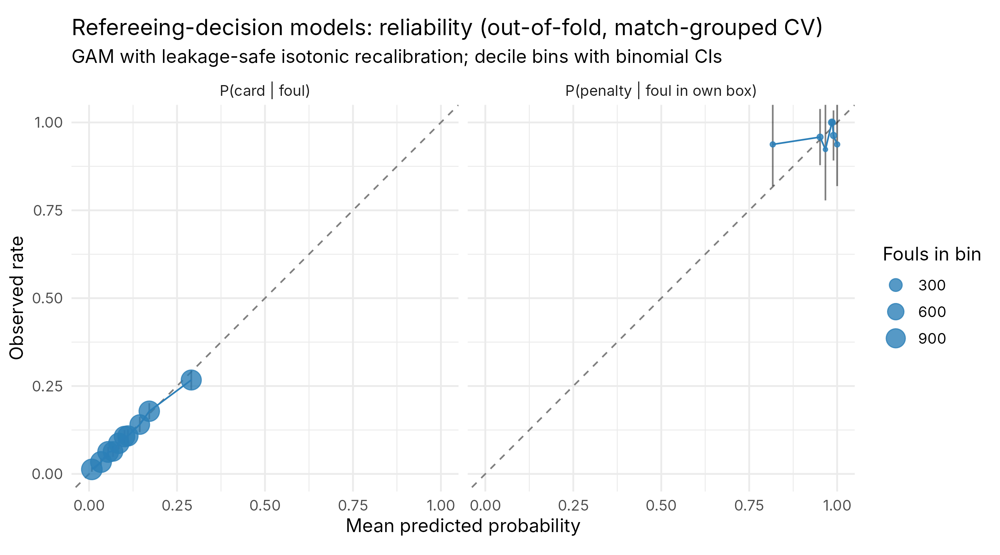
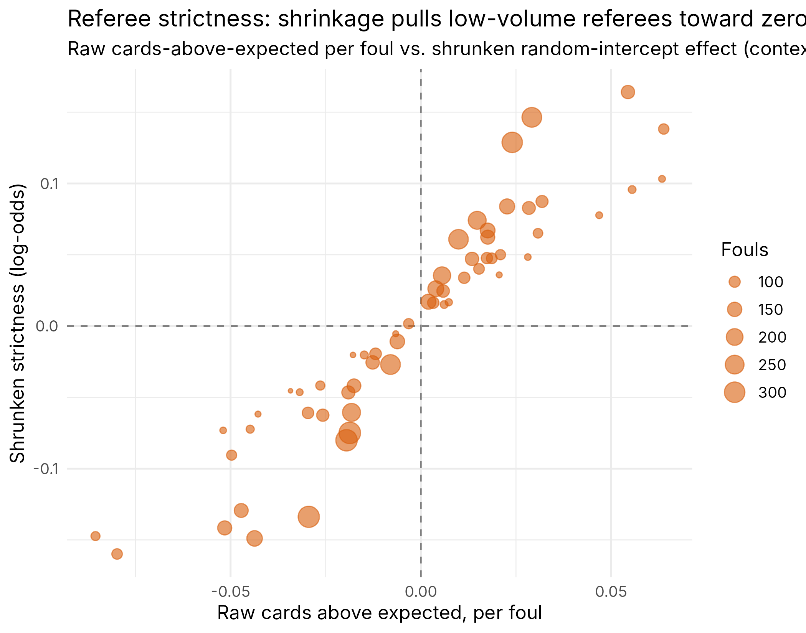
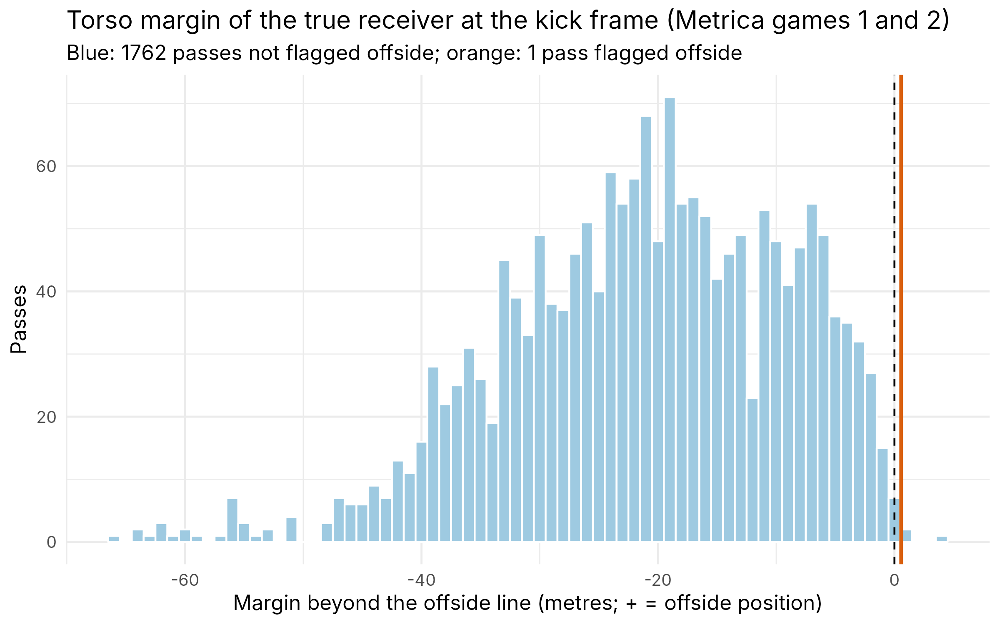

# VAR-Lab: refereeing-decision models and a Law 11 offside engine on open data

Status: layers 1 and 2 of the plan in [`docs/var_vision_scope.md`](../docs/var_vision_scope.md) (milestones M0 to M3). Layer 3 (video) is not started: it needs SoccerNet access, Python/PyTorch and a GPU, none of which this build environment has.

Data: StatsBomb Open Data (non-commercial licence, no redistribution; attribution and logo required), 426 matches with 360 freeze frames across 12 competition-seasons; Metrica Sports sample tracking data (2 anonymised games; no formal licence, Metrica asks for responsible use and acknowledgement). Nothing here is, or claims to be, VAR-grade: official systems track 29 body points per player at 50 Hz with a 500 Hz ball sensor; this project works on 2D torso-level snapshots and event timestamps.

## Headline results

| Question | Answer | Where |
|---|---|---|
| How many refereeing decisions does open data hold? | 10,540 fouls (1,103 carded, 143 penalties), 279 bad-behaviour cards, 1,348 offside passes, 144 offside events; 85% of fouls and 87% of offside passes have a 360 frame | [`decisions_counts.md`](decisions_counts.md) |
| Can a context model predict a card, out of fold? | Yes: GAM log loss 0.305 vs 0.335 base rate (95% CI of the gap excludes zero), ECE 0.005, no drop on held-out referees | [`decision_models.md`](decision_models.md) |
| Can it predict a penalty for a foul in the box? | No model beats the base rate: 143 of 148 own-box fouls were penalties, so there is nothing to learn beyond the rule | [`decision_models.md`](decision_models.md) |
| Do referees differ in strictness after context? | A little: random-intercept SD 0.17 on the logit scale; split-half persistence r 0.20 (p 0.17); referee identity adds nothing out of sample | [`decision_models.md`](decision_models.md) |
| Does the Law 11 engine agree with referee offside calls on 360 frames? | 87% overall, 91% when the margin exceeds 2 yards, 97% when the opposing keeper is in frame; it abstains on 24% of frames and is 91% accurate on the rest | [`offside_360.md`](offside_360.md) |
| What does one frame of kick-timing error cost on real tracking? | 4 cm at the median, 12 cm at the 90th percentile, per 40 ms frame; 42.8% of passes move more than the 5 cm manual tolerance |  [`offside_tracking.md`](offside_tracking.md) |

## Layer 1: calibrated refereeing-decision models

The ingest (`R/06_ingest_decisions.R`) pulls every Foul Committed, Foul Won, Bad Behaviour, Offside and Pass Offside event from the matches with 360 data, joins each to its freeze frame on `event_uuid`, and attaches the match referee. Counts are regenerated from the data on every run.

`R/07_decision_models.R` fits a logistic baseline and an mgcv GAM for P(card | foul) on identical match-grouped folds (the xg-lab discipline) and again on referee-grouped folds (transport to an unseen referee). Features: foul location, foul type, offensive foul, advantage played, minute, position group, competition type, and three 360-derived features (team-mates goal-side of the foul, nearest opponent distance, opponents within 5 yards; median-imputed with a missing flag when the frame is absent). Scores are out of fold with cluster-bootstrap intervals over matches; recalibration is per-fold isotonic fitted on the other folds.

| P(card \| foul), match-grouped CV | Log loss | Gap to base rate [95% CI] | ECE |
|---|---|---|---|
| Base rate | 0.3352 | 0 | 0.000 |
| Logistic | 0.3126 | -0.0226 [-0.0267, -0.0187] | 0.004 |
| GAM | 0.3054 | -0.0299 [-0.0341, -0.0252] | 0.005 |
| GAM, referee-grouped CV | 0.3059 | -0.0293 [-0.0338, -0.0248] | 0.005 |

The abstention curve turns the model into a "check": with the 25% of fouls it is most sure about (p at most 0.05 or at least 0.95) it is 97% accurate; at 54% coverage it is 94.5% accurate; at full coverage 89.5%, which is the base rate of "no card".



Referee effects (`R/08_referee_effects.R`) mirror the finishing-skill analysis: a glmer random intercept per referee with the context model as an offset. The strictest and most lenient referees differ by about 0.3 on the logit scale, every interval straddles zero, and the out-of-sample log loss with referee identity (0.2988) is indistinguishable from without (0.2985). Referee strictness in this sample is mostly noise once the foul's context is accounted for.



## Layer 2: Law 11 geometry engine with uncertainty

`R/09_offside_engine.R` is a pure function of positions: the receiver is in an offside position when it is beyond the furthest-forward of the second-last defender, the ball and the halfway line; level is onside. A Monte Carlo jitters every position (and optionally the kick time along velocities) and returns P(offside), a 90% margin interval and a three-way call: offside, onside, or refer when the interval straddles zero. Ten test blocks with 64 hand-computed assertions cover the halfway rule, the ball-ahead rule, level players, a missing defender, point-in-polygon, and positional and timing noise in both Monte-Carlo implementations.

### On StatsBomb 360 frames (`R/10_offside_360.R`)

Frames carry no player ids, so the receiver is inferred as the team-mate nearest the pass end point. Positives are all 1,177 Pass Offside events with a frame; negatives are 15 completed forward passes per match.

| Stratum | n | Sensitivity | False-positive rate | Agreement beyond 2 yd |
|---|---|---|---|---|
| All evaluable frames | 6,632 | 0.676 | 0.087 | 0.908 [0.900, 0.916] |
| Opposing keeper in frame | 1,689 | 0.736 | 0.022 | 0.974 [0.963, 0.982] |
| Opposing keeper not in frame | 4,943 | 0.649 | 0.108 | 0.889 [0.878, 0.898] |
| 8+ defenders visible | 5,101 | 0.746 | 0.047 | 0.958 [0.951, 0.964] |
| Fewer than 8 defenders visible | 1,531 | 0.458 | 0.225 | 0.744 [0.719, 0.768] |
| Ground passes | 4,557 | 0.856 | 0.058 | 0.966 [0.959, 0.971] |
| Lofted or high passes | 2,075 | 0.567 | 0.176 | 0.749 [0.725, 0.771] |

The pattern is the point: when the defensive line is in shot and the receiver is unambiguous, the 2D engine reproduces the referee's call 96 to 97% of the time beyond 2 yards; when the keeper or the line is out of frame, or the pass is lofted and the receiver inference breaks, agreement collapses. The three-way call at 1 yard of assumed noise refers 24% of frames and is 91% accurate on the rest. A probit fit of P(call | margin) gives an effective noise width of 13 yards across all frames, a failure measure of the whole chain, but 3.6 yards (95% CI 2.5 to 4.6) on well-observed frames (keeper in frame, 8+ defenders visible, n = 1,598) with the midpoint at -0.1 yards: under good visibility the 2D line is unbiased and its combined positional, receiver-inference and timing noise is about 3.5 yards, versus the centimetre tolerances of the official systems.


### On continuous tracking (`R/11_offside_tracking.R`)

Metrica Sports' two sample games give 25 Hz positions for all 22 players and the ball, pass events with the receiver's identity, and explicit offside flags. For each of 1,763 passes the engine evaluates the margin of the true receiver at the kick frame, the margin under the two receiver heuristics used on 360 frames, and the margin at kick frame plus or minus one and two frames; a vectorised Monte Carlo jitters positions by 0.3 m and the kick time by 20 ms along finite-difference velocities.

| Measure | Value |
|---|---|
| False-positive rate, true receiver (passes not flagged offside with margin > 0) | 0.2% [0.1%, 0.6%] of 1,762 |
| False-positive rate, nearest-to-end-point receiver | 0.2% [0.1%, 0.5%] |
| False-positive rate, furthest-forward attacker | 14.8% [13.2%, 16.5%] |
| Nearest-to-end-point heuristic picks the true receiver | 97.1% of passes |
| Margin change for a 1-frame (40 ms) kick-time shift | median 0.04 m, 90th percentile 0.12 m |
| Margin change for a 2-frame shift | median 0.08 m, 90th percentile 0.23 m |
| Passes whose margin moves more than 5 cm for a 1-frame shift (2-frame shift) | 42.8% (68.1%) |
| Three-way Monte-Carlo call on unflagged passes | 1,752 onside, 7 refer, 3 offside |

Only one provider-flagged offside follows a pass in these games (the other followed a ball recovery). Its margin was +0.57 m with P(offside) 0.91, and the engine's call was "refer": a genuinely tight decision that a 2D torso model should not pretend to settle. The two useful numbers are the near-zero false-positive rate when the receiver and the whole defensive line are known, and the receiver heuristic's 97% hit rate, which bounds how much of the 360-frame disagreement comes from receiver inference rather than from missing players.



## Official VAR vs. this project

| | Official SAOT (FIFA 2022 spec; Premier League and La Liga similar) | VAR-Lab |
|---|---|---|
| Positions | 29 body points per player, 50 Hz, 12 to 16 roof cameras | 2D torso point per visible player, one snapshot per event |
| Kick point | 500 Hz ball sensor (FIFA, La Liga from 2026/27); optical + human validation (Premier League) | event timestamp; frame timing undocumented |
| Line precision | centimetres (vendor claims; manual-line tolerance reported at 5 cm, unverified) | yards; assumed 1 yd noise; 13 yd effective width across all frames |
| Decision | VAR validates, referee decides; interference is human | three-way call with abstention; no interference judgement |
| Fouls and cards | human judgement from replays | calibrated P(card) from context, 0.305 log loss; no video |

## What this will never do

Make or recommend a decision in a sanctioned match; goal-line decisions; centimetre offside lines or kick-point timing; interference, deliberate-play, handball or mistaken-identity judgement; real-time operation; any VAR-grade or FIFA Quality claim; auditing actual VAR reviews, because none are public.

## Reproduce

```bash
# data: StatsBomb events + 360 for the 426 matches (about 4 GB, cached under data/sb_raw/)
Rscript R/06_ingest_decisions.R          # ~30 min on 3 cores
Rscript R/07_decision_models.R           # card / penalty models, bootstrap CIs
Rscript R/08_referee_effects.R           # referee shrinkage + persistence
Rscript R/10_offside_360.R               # Law 11 engine on 360 frames
git clone --depth 1 https://github.com/metrica-sports/sample-data.git data/external/metrica
Rscript R/11_offside_tracking.R          # Law 11 engine on 25 Hz tracking
# or everything after the xG pipeline:  XG_VARLAB=1 Rscript run_all.R
Rscript -e 'for (f in list.files("R", full.names = TRUE)) source(f); testthat::test_dir("tests")'
```

## Python port (`varlab/`)

`varlab/calibration.py` ports the R scoring helpers (log loss, Brier, equal-width ECE, Murphy decomposition, equal-count reliability bins, per-fold isotonic recalibration, grouped folds, abstention curve) with R's own `seq`, `cut` and type-7 quantile semantics. `pytest tests/python` runs 40 hand-computed and R-verified unit tests plus 4 parity tests; on the card model's 10,540 out-of-fold predictions (exported by `tools/export_parity.R`) every metric, decile bin and isotonic output matches R within 1e-6. Documented differences: fold membership cannot reproduce R's random stream (the grouping guarantee is identical), and out-of-range or empty inputs raise instead of returning NA.

```bash
pip install -e . && Rscript tools/export_parity.R <oof.rds> data/parity && pytest tests/python -q
```

## Verification tags

Numbers in this document are computed by the scripts named above and regenerate from a clean clone. Official-system figures come from the verification pass recorded in `docs/var_vision_scope.md`; items marked unverified there remain unverified here.
